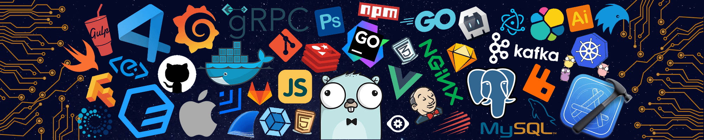

 

  

<h1 align="center">¡Hola! Soy Pablitus 👋</h1>

<h3 align="center">PABLITUS SOFTWARE & WEB</h3>

  Desarrollo de Software · Desarrollo Web · Automatización · Inteligencia Artificial

  <strong>Ideas into Digital Solutions.</strong>

<table align="center">
  <tr>
    <td align="center">
      
    </td>
    <td align="center">
      
    </td>
    <td align="center">
      
    </td>
  </tr>
</table>

 

  

---

<h2 align="center">👨‍💻 Sobre mí | About Me</h2>

¡Hola! Soy Pablitus, desarrollador independiente de software y soluciones web desde Tarija, Bolivia.

Me apasiona crear herramientas digitales que resuelvan problemas reales, simplifiquen tareas y mejoren la experiencia de las personas. Trabajo en proyectos de escritorio, aplicaciones web, automatización y soluciones tecnológicas.

Hello! I'm Pablitus, an independent software and web developer from Tarija, Bolivia.

I'm passionate about building digital tools that solve real-world problems, simplify tasks, and improve people's experiences. I work on desktop applications, web applications, automation, and technology solutions.

<h2 align="center">🚀 Servicios | Services</h2>

| Servicio | Descripción |
|:---|:---|
| 💻 Desarrollo de software | Aplicaciones y herramientas personalizadas. |
| 🌐 Desarrollo web | Sitios web modernos y aplicaciones web. |
| ⚙️ Automatización | Herramientas para optimizar tareas y procesos. |
| 🤖 Soluciones tecnológicas | Integración de tecnologías y nuevas herramientas digitales. |

<h2 align="center">🛠️ Proyectos | Projects</h2>

| Proyecto | Descripción | Tecnología |
|:---|:---|:---|
| [Audio-Converter](https://github.com/Pablitus666/Audio-Converter) | Conversión de archivos de audio. | C# / .NET |
| [Image_Converter](https://github.com/Pablitus666/Image_Converter) | Conversión de imágenes. | Python |
| [Sleep---Alarm](https://github.com/Pablitus666/Sleep---Alarm) | Herramienta de alarma y temporizador. | C# / .NET |
| [Info-RAM](https://github.com/Pablitus666/Info-RAM) | Información del uso de memoria RAM. | C# / .NET |
| [ClearCacheIcons](https://github.com/Pablitus666/ClearCacheIcons) | Utilidad para limpiar la caché de iconos. | C# |
| [Shutdown-Utility-for-Windows](https://github.com/Pablitus666/Shutdown-Utility-for-Windows) | Utilidad para administrar el apagado de Windows. | C# / WinForms |
| [Camara-Gesell-Web](https://github.com/Pablitus666/Camara-Gesell-Web) | Proyecto web de Cámara Gesell. | JavaScript / PWA |

<h2 align="center">💻 Tecnologías | Technologies</h2>

  

<h2 align="center">📊 Estadísticas de GitHub | GitHub Stats</h2>

<table align="center">
  <tr>
    <td align="center">
      
    </td>
    <td align="center">
      
    </td>
  </tr>
</table>

<h2 align="center">🌎 Encuéntrame | Find Me</h2>

  
  
  
  

<h2 align="center">📩 Contacto | Contact</h2>

¿Tienes una idea, necesitas desarrollar un proyecto o buscas una solución tecnológica? ¡Hablemos!

Do you have an idea, need a project developed, or are you looking for a technology solution? Let's talk!

<table align="center">
  <tr>
    <td align="center">
      
    </td>
    <td align="center">
      
    </td>
  </tr>
</table>

  📍 Tarija, Bolivia

---

  <strong>PABLITUS SOFTWARE & WEB</strong> 
  <em>Ideas into Digital Solutions.</em>

